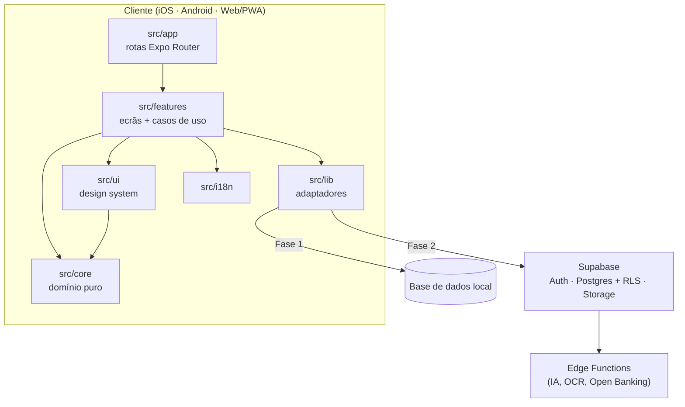

# Arquitetura do CentFlow

## Visão geral

Uma única base de código TypeScript (Expo + React Native) gera as apps iOS e Android e a versão
Web/PWA (via `react-native-web`). A lógica de negócio vive em módulos sem dependências de interface,
para poder ser reutilizada no servidor (Supabase Edge Functions) e em futuros clientes desktop.



## Camadas

| Camada         | Responsabilidade                                                  | Pode depender de     |
| -------------- | ----------------------------------------------------------------- | -------------------- |
| `src/app`      | Mapa de rotas. Cada ficheiro só renderiza um ecrã de `features`.  | features             |
| `src/features` | Ecrãs, componentes específicos, hooks e casos de uso por área.    | ui, core, i18n, lib  |
| `src/ui`       | Tema, tokens, componentes genéricos e layout responsivo.          | core, i18n           |
| `src/core`     | Regras de domínio em TypeScript puro (dinheiro, datas, cálculos). | nada (só Intl)       |
| `src/i18n`     | Traduções, resolução de idioma e formatação localizada.           | core                 |
| `src/lib`      | Acesso a armazenamento/serviços (hoje: AsyncStorage).             | bibliotecas externas |

Cada feature organiza-se, à medida que cresce, em:

```
features/<área>/
  <Área>Screen.tsx      ecrã (composição de componentes)
  components/           componentes só desta área
  hooks/                estado e ligação aos dados
  <área>.ts             tipos e regras da área (sem React quando possível)
  repository.ts         interface de acesso a dados + implementações
  __tests__/
```

O acesso a dados é sempre feito através de **repositórios com interface** (exemplo atual:
`createPreferencesRepository(store)`). Isto permite trocar a implementação local da Fase 1 pela
sincronizada da Fase 2 sem tocar nos ecrãs, e testar com armazenamento em memória.

## Fluxo de arranque

1. `expo-router/entry` carrega `src/app/_layout.tsx`.
2. `@/i18n` inicializa o i18next de forma síncrona com o idioma do dispositivo.
3. `AppProviders` mantém o splash nativo até as **fontes** e as **preferências** (tema, idioma)
   estarem carregadas — evita "flash" de tema ou idioma errado.
4. `ThemeProvider` resolve o esquema (sistema/claro/escuro), sincroniza o tema da navegação, a
   status bar e a cor de fundo do sistema.
5. O `Stack` raiz contém os separadores `(tabs)`, o modal `new-transaction` e `+not-found`.
6. `RootErrorBoundary` apanha erros não tratados sem depender dos providers.

## Navegação adaptativa

Usa as tabs JavaScript estáveis do Expo Router com uma barra própria (`AppTabBar`):

| Largura    | Breakpoint | Navegação                                                      |
| ---------- | ---------- | -------------------------------------------------------------- |
| < 768px    | compact    | Barra inferior: Dashboard, Movimentos, **+**, Orçamentos, Mais |
| 768–1199px | medium     | Sidebar compacta (só ícones)                                   |
| ≥ 1200px   | expanded   | Sidebar completa com grupos e botão "Novo movimento"           |

As nove áreas existem como rotas reais em todos os tamanhos; em telemóvel, as secundárias estão em
"Mais". Os URLs são estáveis (`/transactions`, `/vehicles`, …), o que serve deep links, atalhos e
widgets.

## Plataformas e desktop

- **iOS/Android:** builds via EAS. Funcionalidades nativas (câmara, notificações, widgets) entram
  por módulos Expo e config plugins.
- **Web/PWA:** `web.output = "single"` (SPA, adequada a uma app autenticada sem necessidade de SEO).
  `public/index.html` e `public/manifest.json` tornam a app instalável em Windows, macOS e Linux.
- **Desktop nativo (futuro):** o build web pode ser empacotado com Tauri ou Electron sem
  reescrever lógica. Se for preciso partilhar `core` com outros clientes, extrair para um
  workspace (`packages/core`) — a regra de lint já garante que `core` não depende de React Native.

## Evolução prevista por fase

- **Fase 1 — dados locais:** base de dados local (ver decisão pendente em `decisions.md`),
  repositórios por entidade (contas, movimentos, categorias), cálculos do dashboard em `core`
  (testados), formulário de registo rápido no modal existente.
- **Fase 2 — Supabase:** `src/lib/supabase` com cliente usando apenas a chave pública (anon);
  sessão em armazenamento seguro; `supabase/migrations/*.sql` versionadas; RLS
  `auth.uid() = user_id` em todas as tabelas pessoais; Storage com políticas por utilizador;
  sincronização com identificadores gerados no cliente (UUID) e `updated_at` para resolução de
  conflitos; migração única dos dados locais após o primeiro login; eliminação de conta.
- **Fase 5 — IA e automação:** chamadas a modelos e OCR apenas em Edge Functions (chaves nunca no
  cliente); a IA propõe, o utilizador confirma. Importação de extratos e Open Banking através de
  fornecedores autorizados (PSD2), sempre com consentimento explícito.
