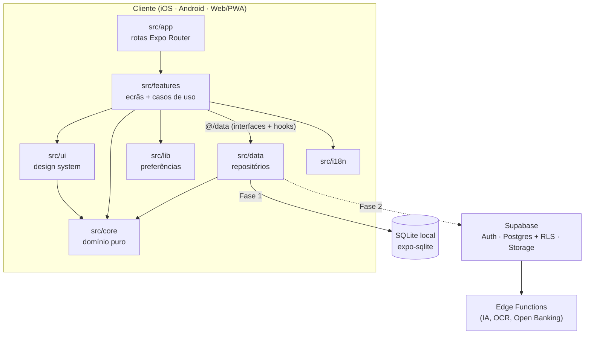
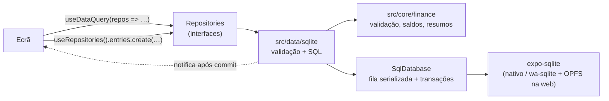

# Arquitetura do CentFlow

## Visão geral

Uma única base de código TypeScript (Expo + React Native) gera as apps iOS e Android e a versão
Web/PWA (via `react-native-web`). A lógica de negócio vive em módulos sem dependências de interface,
para poder ser reutilizada no servidor (Supabase Edge Functions) e em futuros clientes desktop.



## Camadas

| Camada         | Responsabilidade                                                  | Pode depender de              |
| -------------- | ----------------------------------------------------------------- | ----------------------------- |
| `src/app`      | Mapa de rotas. Cada ficheiro só renderiza um ecrã de `features`.  | features                      |
| `src/features` | Ecrãs, componentes específicos, hooks e casos de uso por área.    | ui, core, i18n, lib, `@/data` |
| `src/ui`       | Tema, tokens, componentes genéricos e layout responsivo.          | core, i18n                    |
| `src/core`     | Regras de domínio em TypeScript puro (dinheiro, datas, cálculos). | nada (só Intl)                |
| `src/data`     | SQLite, migrações, repositórios, hooks `useDataQuery`.            | core, expo-sqlite             |
| `src/i18n`     | Traduções, resolução de idioma e formatação localizada.           | core                          |
| `src/lib`      | Preferências (AsyncStorage).                                      | bibliotecas externas          |

Cada feature organiza-se, à medida que cresce, em:

```
features/<área>/
  <Área>Screen.tsx      ecrã (composição de componentes)
  components/           componentes só desta área
  hooks/                estado e ligação aos dados
  <área>.ts             tipos e regras da área (sem React quando possível)
  repository.ts         interface de acesso a dados + implementações
  __tests__/
```

O acesso a dados é sempre feito através de **repositórios com interface** (preferências:
`createPreferencesRepository(store)`; dados financeiros: `Repositories` em
`src/data/repositories/types.ts`). Isto permite acrescentar a implementação sincronizada da
Fase 2 sem tocar nos ecrãs, e testar com SQLite em memória.

## Dados locais (Fase 1)



- **`SqlDatabase`** (`src/data/db/sql-database.ts`) envolve um subconjunto da API do
  `expo-sqlite` (`execAsync`, `runAsync`, `getAllAsync`, `getFirstAsync`,
  `withTransactionAsync`, `closeAsync`). Todas as operações passam por uma fila: o `expo-sqlite`
  tem uma única ligação e uma transação aberta não isola outras operações assíncronas. Erros do
  driver são classificados (`constraint`, `foreignKey`, `busy`, `unknown`).
- **Arranque** (`initializeDatabase`): `PRAGMA foreign_keys = ON` (verificado), WAL só em nativo,
  migrações por `PRAGMA user_version`, cada versão numa transação.
- **Repositórios SQLite** validam com as funções de `src/core/finance/validation.ts` dentro da
  transação de escrita (contra o estado atual das contas e categorias), gravam e notificam os
  subscritores só depois do commit. O `DashboardScreen` e as listas voltam a consultar
  automaticamente.
- **Agregações**: o SQL agrega por mês, moeda, tipo e categoria (`entries.aggregate`) e por conta
  (`accounts.getFlows`); a interpretação (saldo, taxa de poupança, tendência) é feita no `core`.
- **Arranque da UI**: `DataGate` (em `AppProviders`) abre a base de dados, semeia as categorias
  base traduzidas uma única vez e só então mostra a app. Falhas mostram um ecrã explicativo com
  "Tentar novamente".

### Esquema (migração v1)

| Tabela       | Colunas principais                                                                                                                                        | Integridade                                                                                                                             |
| ------------ | --------------------------------------------------------------------------------------------------------------------------------------------------------- | --------------------------------------------------------------------------------------------------------------------------------------- |
| `accounts`   | `id`, `name`, `type`, `currency`, `initial_balance` (INTEGER), `archived_at`                                                                              | `CHECK` de tipo, moeda ISO maiúscula, saldo inteiro                                                                                     |
| `categories` | `id`, `name`, `type` (`income`/`expense`), `icon`, `color` (chave da paleta)                                                                              | `CHECK` de tipo e nome                                                                                                                  |
| `entries`    | `id`, `type`, `amount` (INTEGER > 0), `description`, `search_text`, `category_id`, `account_id`, `destination_account_id`, `date` (`YYYY-MM-DD`), `notes` | FKs `ON DELETE RESTRICT`; transferência ⇔ sem categoria e com conta destino diferente; rendimento/despesa ⇔ com categoria e sem destino |
| `meta`       | `key`, `value`                                                                                                                                            | Marcadores internos (ex.: categorias base já semeadas)                                                                                  |

Todas as tabelas de dados têm `created_at`, `updated_at`, `deleted_at` e `synced_at`. Índices
parciais (`WHERE deleted_at IS NULL`) por data, conta+data, conta destino, categoria+data,
tipo+data, contas ativas e tipo de categoria.

### Regras financeiras

- Saldo de uma conta = saldo inicial + rendimentos − despesas − transferências enviadas +
  transferências recebidas. Contas arquivadas mantêm o saldo mas saem do total.
- Transferências não entram em rendimentos, despesas, poupança nem despesas por categoria.
- Taxa de poupança = (rendimentos − despesas) / rendimentos; sem rendimentos não é calculada.
- Totais nunca misturam moedas: o dashboard usa a moeda mais frequente das contas ativas e lista
  as restantes à parte.

### Web

- `expo-sqlite` usa wa-sqlite (WebAssembly) num worker, com o VFS `AccessHandlePoolVFS` sobre o
  Origin Private File System. Exige `SharedArrayBuffer`, logo **isolamento cross-origin**
  (`Cross-Origin-Embedder-Policy: credentialless`, `Cross-Origin-Opener-Policy: same-origin`).
- Em desenvolvimento, `metro.config.js` acrescenta os cabeçalhos a todas as respostas do servidor
  (o HTML é servido por um middleware da Expo CLI anterior ao do Metro, por isso
  `enhanceMiddleware` sozinho não chega). Em produção: `public/_headers` (Netlify/Cloudflare) ou
  configuração equivalente do alojamento; `npm run serve:web` para testar localmente.
- O OPFS com `AccessHandlePoolVFS` é exclusivo por origem. `openAppRepositories` pede um Web Lock
  (`navigator.locks`, `ifAvailable`) antes de abrir; um segundo separador recebe o motivo
  `otherTab` em vez de corromper ou bloquear os dados.

## Fluxo de arranque

1. `expo-router/entry` carrega `src/app/_layout.tsx`.
2. `@/i18n` inicializa o i18next de forma síncrona com o idioma do dispositivo.
3. `AppProviders` mantém o splash nativo até as **fontes** e as **preferências** (tema, idioma)
   estarem carregadas — evita "flash" de tema ou idioma errado.
4. `ThemeProvider` resolve o esquema (sistema/claro/escuro), sincroniza o tema da navegação, a
   status bar e a cor de fundo do sistema.
5. `DataGate` abre a base de dados local, aplica migrações e semeia as categorias base.
6. O `Stack` raiz contém os separadores `(tabs)`, os modais de formulário (`new-transaction`,
   `entry/[id]`, `account/new`, `account/[id]`, `category/new`, `category/[id]`) e `+not-found`.
7. `RootErrorBoundary` apanha erros não tratados sem depender dos providers.

## Navegação adaptativa

Usa as tabs JavaScript estáveis do Expo Router com uma barra própria (`AppTabBar`):

| Largura    | Breakpoint | Navegação                                                      |
| ---------- | ---------- | -------------------------------------------------------------- |
| < 768px    | compact    | Barra inferior: Dashboard, Movimentos, **+**, Orçamentos, Mais |
| 768–1199px | medium     | Sidebar compacta (só ícones)                                   |
| ≥ 1200px   | expanded   | Sidebar completa com grupos e botão "Novo movimento"           |

As onze áreas (incluindo Contas e Categorias) existem como rotas reais em todos os tamanhos; em
telemóvel, as secundárias estão em "Mais". Os URLs são estáveis (`/transactions`, `/vehicles`, …), o que serve deep links, atalhos e
widgets.

## Plataformas e desktop

- **iOS/Android:** builds via EAS. Funcionalidades nativas (câmara, notificações, widgets) entram
  por módulos Expo e config plugins.
- **Web/PWA:** `web.output = "single"` (SPA, adequada a uma app autenticada sem necessidade de SEO).
  `public/index.html` e `public/manifest.json` tornam a app instalável em Windows, macOS e Linux.
- **Desktop nativo (futuro):** o build web pode ser empacotado com Tauri ou Electron sem
  reescrever lógica. Se for preciso partilhar `core` com outros clientes, extrair para um
  workspace (`packages/core`) — a regra de lint já garante que `core` não depende de React Native.

## Evolução prevista por fase

- **Fase 1 — dados locais (concluída):** ver "Dados locais" acima.
- **Fase 2 — Supabase:** implementação de `Repositories` sincronizada ou combinada com a local
  (as colunas `deleted_at`/`synced_at` e os UUID gerados no cliente já existem); `src/lib/supabase` com cliente usando apenas a chave pública (anon);
  sessão em armazenamento seguro; `supabase/migrations/*.sql` versionadas; RLS
  `auth.uid() = user_id` em todas as tabelas pessoais; Storage com políticas por utilizador;
  sincronização com identificadores gerados no cliente (UUID) e `updated_at` para resolução de
  conflitos; migração única dos dados locais após o primeiro login; eliminação de conta.
- **Fase 5 — IA e automação:** chamadas a modelos e OCR apenas em Edge Functions (chaves nunca no
  cliente); a IA propõe, o utilizador confirma. Importação de extratos e Open Banking através de
  fornecedores autorizados (PSD2), sempre com consentimento explícito.
